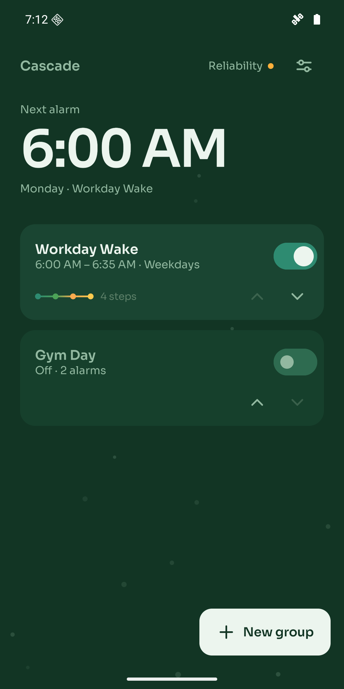
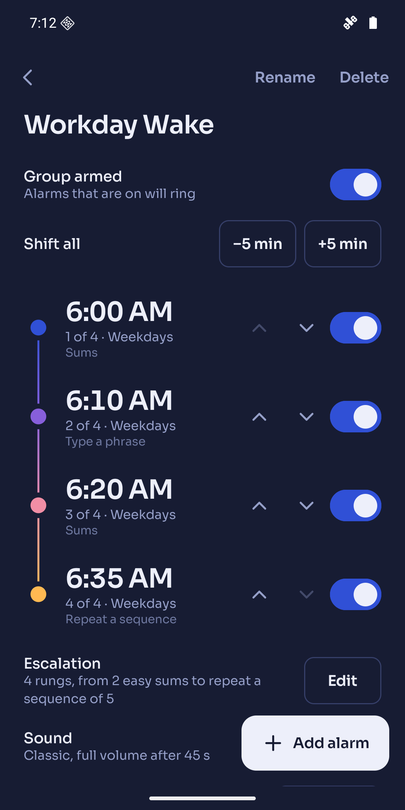
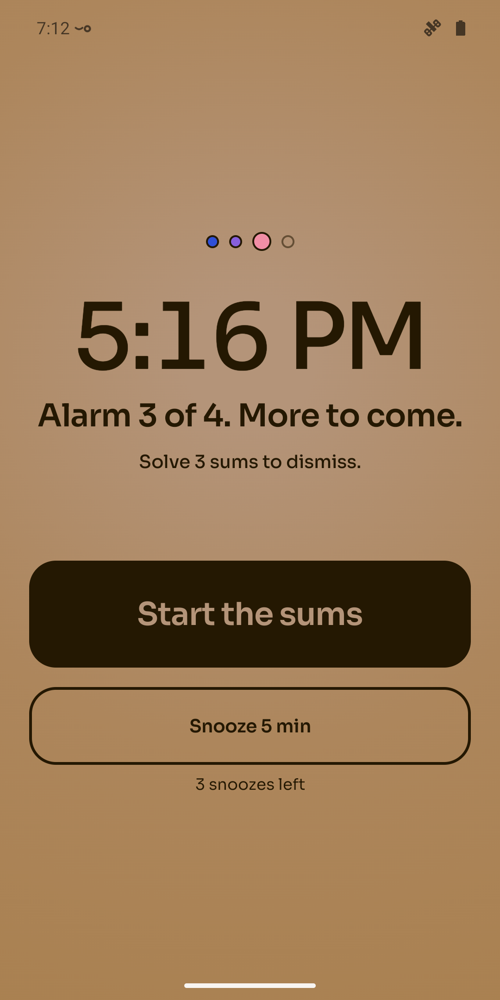
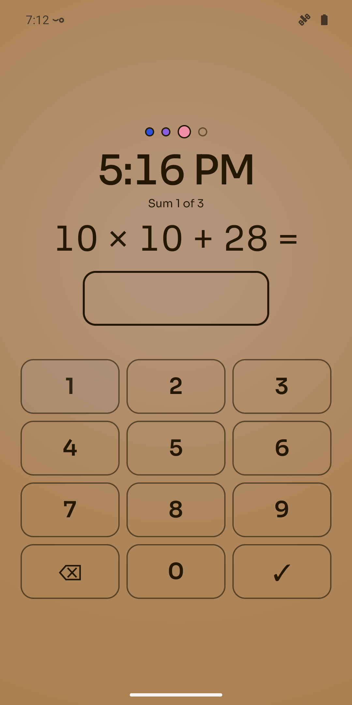
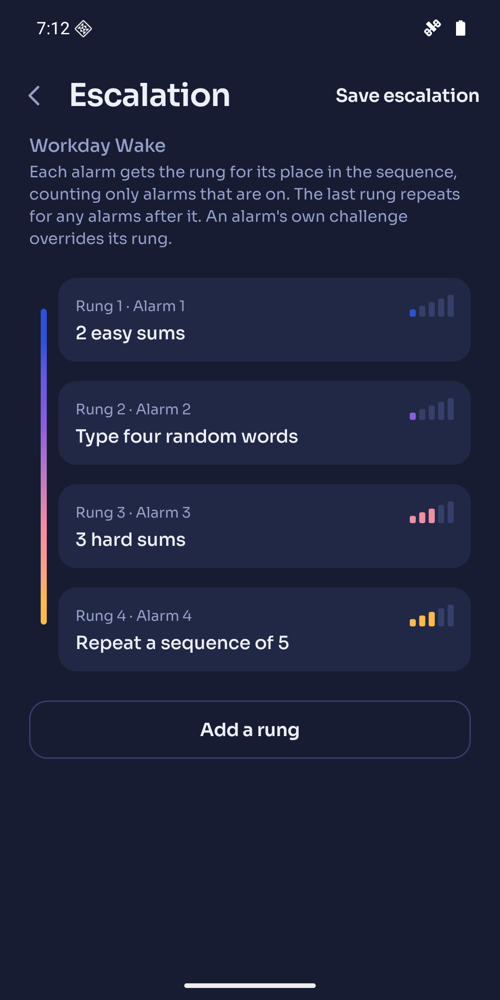
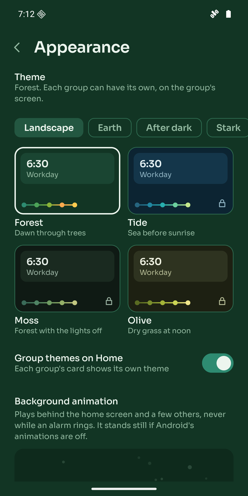
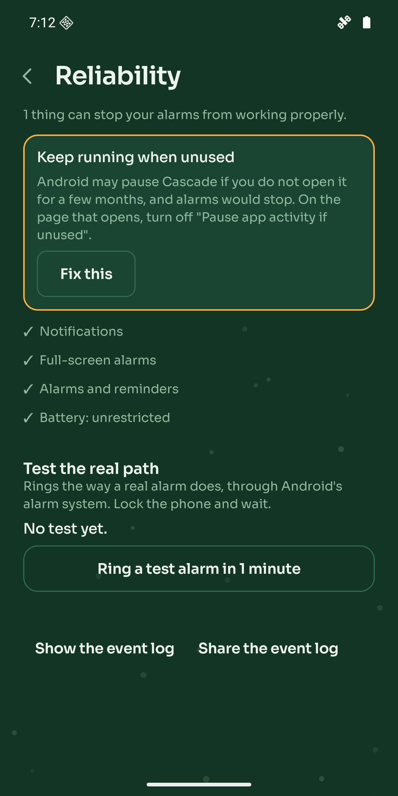

<p align="center">
  
</p>

<h1 align="center">Cascade</h1>

<p align="center">
  <strong>Alarms that get harder.</strong><br>
  An Android alarm clock built around groups of alarms, where each one is tougher to turn off than the last.
</p>

<p align="center">
  <a href="https://github.com/ttrevorreese/cascade/actions/workflows/ci.yml"></a>
  
  
  
</p>

<p align="center">
  
  
  
  
</p>

---

## Why

Most alarm apps treat five alarms ten minutes apart as user error. For a lot of people it is simply
how they wake up. Cascade makes the sequence the thing you set up: build **Workday Wake** once
(6:00, 6:10, 6:20, 6:35), switch it on Sunday night, and switch it off for the holidays with one tap.

Then it makes the sequence work for you. The first alarm is a gentle nudge. By the last one you are
solving sums, typing a phrase, or scanning the QR code taped to the bathroom mirror.

## Features

**Groups of alarms**
- A group is a named sequence of alarms armed and disarmed with one switch.
- Move the first alarm and the rest follow by the same amount, or shift the whole group by five minutes.
- A **wake-up check** a few minutes after the last alarm: miss it and the alarm rings again.

**Escalation**
- Each group has a ladder of challenges, one rung per alarm position: sums, typing a phrase,
  scanning a QR code or barcode, matching a photo of a place, walking a number of steps, and
  repeating a sequence.
- One tap gives a sensible starter ladder; any alarm can override its rung.
- Challenges are built to resist half-asleep workarounds, and there is always an honest way out
  ("give up") that is logged rather than hidden.

**Sound and voice**
- Eight built-in tones or any audio file from your phone, getting louder over 30 to 60 seconds.
- **Read aloud**: an alarm can say the time and its label ("It's 6:10 AM. Take your pills.") in
  any offline voice on your phone.
- Snooze per alarm, never on the group's last.

**Reliability first**
- Rings through Android's alarm-clock path with a foreground service, before the phone is first
  unlocked after a restart, and after the phone was switched off over the alarm time.
- A **Reliability Check** lists anything on the phone that could stop an alarm, with a button to fix
  each, and rings a real test alarm.
- Missed or late alarms are detected and explained on the home screen, with the likely cause.
- If a sound cannot play it falls back (your sound, then Classic, then the phone's alarm sound,
  with vibration throughout), and tells you afterwards.

**Yours to look at**
- 52 themes in 13 families, generated from one design file; each group can have its own.
- Stats for the last 7 or 30 days: time to dismiss, snoozes, challenges and wake-up checks.
- Onboarding that sets up the permissions alarms need and your first group in one go.
- Screen reader labels, headings and announcements throughout; checked at double text size.

## Privacy

Cascade has no account, no analytics, no ads and no servers, and **it does not have Android's
internet permission**. The libraries that would like to send usage statistics to Google are blocked
by Android itself. Alarm data, reference photos and sounds stay in app-private storage, and cloud
backup is off. Settings > Export everything saves it all as one JSON file wherever you choose.

Read the full [privacy policy](https://ttrevorreese.github.io/cascade/privacy.html).

<p align="center">
  
  
  
</p>

## Cascade Plus

The app is free and every alarm feature is in it. Cascade Plus is a one-time purchase that unlocks
the 46 extra themes. Nothing that affects whether you wake up is ever behind it.

## Building

Requirements: Android Studio (its bundled JDK 21), Android SDK 37.

```sh
git clone https://github.com/ttrevorreese/cascade.git
cd cascade
./gradlew assembleDebug                 # app/build/outputs/apk/debug/app-debug.apk
./gradlew testDebugUnitTest             # JVM and Robolectric tests
./gradlew lintDebug                     # CI runs this, the tests and the theme audit
./gradlew connectedDebugAndroidTest     # database migrations and engine, on a device
bash scripts/e2e-alarm.sh --wake-check  # the full alarm path on a device, about 6 minutes
```

Debug builds include adb hooks for testing the engine without waiting for real alarms, for example
`adb shell am broadcast -a com.cascade.alarm.debug.SEED_DEMO -p com.cascade.alarm`. The full list is
in [CLAUDE.md](CLAUDE.md#commands).

## How it is built

| | |
|---|---|
| Language and UI | Kotlin, Jetpack Compose, Material 3 with Cascade's own design tokens |
| Architecture | Hilt, coroutines and Flow; one reconciler owns every change to the schedule |
| Alarms | `AlarmManager.setAlarmClock`, a `systemExempted` foreground service while ringing, Direct Boot aware |
| Storage | Room in device-protected storage (readable before first unlock), versioned migrations with tests |
| Audio | Media3 ExoPlayer on the alarm stream, Android text-to-speech pre-rendered to files |
| Challenges | CameraX, ML Kit barcode scanning (bundled model, offline), the step counter sensor |
| Purchases | Google Play Billing |
| Tests | JUnit 5, Robolectric and Compose UI tests on the JVM; instrumented migration and engine tests; an adb end-to-end script |

```
app/src/main/java/com/cascade/alarm/
├── engine/      scheduling, reconciliation, the ring service and everything on the alarm path
├── data/        Room entities and DAOs, repositories, challenge, sound, voice, stats and export logic
└── ui/          Compose screens: home, group, alarm editor, escalation, ring and challenges, settings
design/          DESIGN.md, themes.json (the single source of every colour) and the theme audit
spec.md          what Cascade does and the decisions made along the way
```

## Status

Feature-complete for version 1 and in release preparation. Phone testing on a Galaxy S22 Ultra and a
closed test on Google Play come next. See [spec.md](spec.md) for the full specification and
milestone history, and [RELEASING.md](RELEASING.md) for the release steps.
